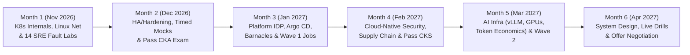

# 6-Month Platform, SRE & AI Infrastructure Execution Plan (Nov 2026 – Apr 2027)

> **Target Profile:** Senior Site Reliability Engineer (SRE) / Platform Engineer / AI Infrastructure Engineer  
> **Foundation:** 13 Years IT Operations, Incident & Change Management, Enterprise Networking (Palo Alto Firewalls) + Hands-On Engineering in [`tf-gcp-k8s-lab`](../../README.md) & [`Barnacles`](../architecture/barnacles-platform.md)  
> **Certification Track:** `CKA` (Dec 2026) $\rightarrow$ `CKS` (Feb 2027)

---

## 1. Strategic Positioning: Turning 13 Years of Operations into an Unfair Advantage

### Why the 2026–2027 Market Rewards This Exact Path
Recent Indian IT and GCC (Global Capability Center) hiring trends show a sharp bifurcation:
- **Contracting Roles:** Traditional L1/L2 infrastructure support, manual ticket routing, and static network/telecom operations.
- **Expanding Roles:** **Platform Engineering** (`31–35%` talent gap), **Cloud-Native & AI Security** (`+12%`), and **AI / Data Infrastructure** (`+14%`).

Layoffs do not target engineers who can **design, automate, secure, and recover** production systems across the stack. Your goal is not to discard your 13 years of IT operations or your exposure to enterprise firewalls—it is to **upgrade your operational maturity into code**.

### How to Frame Your Background (Never Position Yourself as a "Beginner Switcher")

| Positioning Dimension | Weak Framing (Avoid) | Strong Senior SRE / Platform Framing (Use This) |
| :--- | :--- | :--- |
| **13 Years of IT Operations** | *"I worked in L2/Operations support and incident management for 13 years and am now trying to move into Kubernetes."* | *"I spent 13 years owning production availability, major incident command, and change governance, and evolved that operational foundation into automated Platform & SRE engineering using Terraform, self-managed HA Kubernetes, GitOps, and eBPF/Prometheus observability."* |
| **Palo Alto Firewall Exposure** | *"I know basic Palo Alto firewall rules and change tickets."* | *"I understand enterprise network security from the perimeter to the pod—bridging traditional L3/L4/L7 firewall zoning and change governance (Palo Alto) with GCP VPC zero-trust firewall modules, Kubernetes `NetworkPolicies`, Cilium eBPF microsegmentation, and Kyverno admission guardrails."* |
| **Hands-On Depth Proof** | *"I am preparing for CKA and did some labs."* | *"I architected and open-sourced a 7-level self-managed Kubernetes reference platform on GCP (`tf-gcp-k8s-lab`) with stacked `etcd` HA, zero-public-IP IAP bastionless access, WIF CI/CD, a distributed Go log aggregator (`Barnacles`), an Internal Developer Platform (`Argo CD` + `Kyverno`), and a `vLLM` inference stack with 14 automated failure-injection drills."* |

---

### Enterprise Firewall (Palo Alto) $\leftrightarrow$ Cloud & Kubernetes Security Translation Matrix

When interviewers ask about networking or security, use this mental map to connect your enterprise firewall familiarity directly to `tf-gcp-k8s-lab`:

| Palo Alto / Enterprise Firewall Concept | Cloud & Kubernetes Equivalent in `tf-gcp-k8s-lab` | Repo Reference |
| :--- | :--- | :--- |
| **Security Zones (Trust / Untrust / DMZ)** | Custom GCP VPC Subnets + Kubernetes Namespace isolation boundaries | [`terraform/modules/network/main.tf`](../../terraform/modules/network/main.tf) |
| **Inter-Zone Security Policy Rules (L3/L4)** | Strict GCP VPC Firewall rules (`etcd` `2379-2380`, `apiserver` `6443`, `kubelet` `10250`) + K8s `NetworkPolicy` | [`terraform/modules/firewall/main.tf`](../../terraform/modules/firewall/main.tf), [`kubernetes/security/network-policies/`](../../kubernetes/security/network-policies/) |
| **Default Deny / Zero-Trust Rulebase Bottom** | Namespace `default-deny-all` ingress/egress + explicit `allow-dns-egress` | [`default-deny-all.yaml`](../../kubernetes/security/network-policies/default-deny-all.yaml) |
| **Source NAT (Outbound Internet Egress)** | Zero public node IPs + Cloud Router & **Cloud NAT** outbound egress | [`terraform/modules/nat/main.tf`](../../terraform/modules/nat/main.tf) |
| **GlobalProtect VPN / Bastion Access** | Keyless **Google Cloud IAP TCP Forwarding** (`35.235.240.0/20`) + **OS Login** | [`docs/architecture/level-3-hardening.md`](../architecture/level-3-hardening.md) |
| **App-ID & Layer-7 Traffic Inspection** | **Kubernetes `Gateway` API** (`HTTPRoute` canary splitting) & **Cilium eBPF** L7 `CiliumNetworkPolicies` | [`cilium-l7-zero-trust-policy.yaml`](../../kubernetes/security/network-policies/cilium-l7-zero-trust-policy.yaml), [`02-gateway-and-ingress-lab.yaml`](../../kubernetes/networking/02-gateway-and-ingress-lab.yaml) |
| **Threat Prevention & IPS Signatures** | **Falco Modern eBPF** syscall detection (shells in containers, `/etc/shadow` reads, drift, escape) | [`01-falco-ebpf-runtime-defense.yaml`](../../kubernetes/security/runtime-security/01-falco-ebpf-runtime-defense.yaml) |
| **Panorama Central Policy Management** | **GitOps Policy-as-Code** (`Argo CD` `ApplicationSets` + `Kyverno` + `verify-platform-policies.sh`) | [`kubernetes/platform-idp/`](../../kubernetes/platform-idp/), [`verify-platform-policies.sh`](../../scripts/platform/verify-platform-policies.sh) |
| **Packet Capture & Traffic Logs** | `tcpdump`, `conntrack`, `iptables-save`, `nsenter` & automated packet path tracer | [`trace-packet-path.sh`](../../scripts/networking/trace-packet-path.sh), [`30-day-networking-roadmap.md`](../networking/30-day-networking-roadmap.md) |

---

## 2. Weekly Time Allocation (90-Day Core Split)

Maintain **18–21 hours/week** (~2.5 to 3 hours/day on weekdays, 4 hours/day on weekends):

| Focus Pillar | Share | Weekly Hours | Concrete Activities |
| :--- | :---: | :---: | :--- |
| **1. Kubernetes & Platform Engineering** | **60%** | `~11–12 hrs` | Cluster internals, `kubeadm` HA/DR, SRE fault drills (`sre-lab-runner.sh`), `Argo CD` GitOps, Kustomize Golden Paths, `vLLM` serving. |
| **2. Cloud Infrastructure, Terraform & Networking** | **20%** | `~3.5–4 hrs` | GCP VPC/NAT/LB/IAM Terraform modules, Linux `netns`/`veth`/`iptables`/VXLAN packet tracing, `Gateway` API. |
| **3. Cloud-Native Security (`CKS` Track)** | **15%** | `~2.5–3 hrs` | RBAC, Restricted PSS, `NetworkPolicies`, KMS `etcd` encryption, `Kyverno`, `Trivy`, API audit logging, `Falco`. |
| **4. Go / Python & Shell Automation** | **5%** | `~1–1.5 hrs` | Reading/extending `Barnacles` (Go log spooler), `sre-copilot` (Python AIOps webhook), and bash automation scripts. |

---

## 3. The 6-Month Execution Roadmap (Nov 2026 – Apr 2027)

---

### Month 1 (November 2026): Kubernetes Internals, Linux Networking & SRE Troubleshooting Mastery

- **Primary Objective:** Transition from "knowing `kubectl` commands" to diagnosing cluster, control-plane, CNI, and Linux kernel issues from first principles.
- **Technical Curriculum:**
  1. **Weeks 1–2 (Nov 2 – Nov 15):** Execute the **[14-Day Kubernetes Engineering Sprint](README.md)** ([Day 1](day-01-walkthrough.md), [Day 2](day-02-walkthrough.md), [Week 1](days-03-to-07-week1-guide.md), [Week 2](days-08-to-14-week2-guide.md)).
  2. **Weeks 3–4 (Nov 16 – Nov 30):**
     - Provision [`terraform/environments/level1-lab/`](../../terraform/environments/level1-lab/) and [`level2-ha/`](../../terraform/environments/level2-ha/) from scratch.
     - Complete Weeks 1–2 of the **[30-Day Kubernetes & Linux Networking Roadmap](../networking/30-day-networking-roadmap.md)** (build a 2-namespace `veth` + bridge topology by hand; trace VXLAN UDP `:8472` packets with [`scripts/networking/trace-packet-path.sh`](../../scripts/networking/trace-packet-path.sh)).
     - Run all **14 SRE troubleshooting labs** via [`scripts/troubleshooting/sre-lab-runner.sh`](../../scripts/troubleshooting/sre-lab-runner.sh).
- **Portfolio & Career Deliverables:**
  - Complete **5 formal SRE Incident Post-Mortems** using [`docs/labs/incident-report-template.md`](../labs/incident-report-template.md) (recommended: Lab 01 Broken CNI, Lab 02 `etcd` Quorum Loss, Lab 03 Kubelet Cert Expiry, Lab 07 `OOMKilled`, Lab 08 `NetworkPolicy` Blackhole).
  - Update LinkedIn headline and resume to **Site Reliability Engineer / Platform Engineer** (using Section 4 below).

---

### Month 2 (December 2026): HA Control Plane, Zero-Trust Hardening & CKA Certification

- **Primary Objective:** Achieve speed and fluency under time pressure, pass the **CKA exam**, and launch **Wave 1 job applications**.
- **Technical Curriculum:**
  1. **Weeks 1–2 (Dec 1 – Dec 15):**
     - Deploy [`terraform/environments/level3-hardened/`](../../terraform/environments/level3-hardened/) (strict port-level firewall rules, KMS `etcd` encryption, Secret Manager).
     - Drill `etcd` snapshot backup and restore ([`scripts/disaster-recovery/etcd-backup.sh`](../../scripts/disaster-recovery/etcd-backup.sh), [`etcd-restore.sh`](../../scripts/disaster-recovery/etcd-restore.sh)) until you can execute a full restore in **under 6 minutes** without looking at notes.
     - Drill zero-downtime `kubeadm` rolling upgrades (`1.31` $\rightarrow$ `1.32`) using [`scripts/operations/rolling-upgrade.sh`](../../scripts/operations/rolling-upgrade.sh).
     - Complete Weeks 3–4 of the **[30-Day Networking Roadmap](../networking/30-day-networking-roadmap.md)** (`kube-proxy` `iptables` chains, `CoreDNS` `ndots:5`, `Ingress` vs. `Gateway` API, and 10 blind network failure drills).
  2. **Weeks 3–4 (Dec 16 – Dec 31):**
     - Take two full 2-hour timed **Killer.sh** CKA mock sessions. Target score: **`80–85%+`**.
     - **Sit and pass the CKA Exam** before December 31, 2026.
- **Job Search Deliverable (Wave 1 — Late December):**
  - Start applying immediately once CKA is scheduled/completed. Do **not** wait until Month 6.
  - Target **5 high-fit roles per week** (SRE, Cloud Infrastructure Engineer, Kubernetes Engineer) to gather real interview signal early.

---

### Month 3 (January 2027): Platform Engineering, GitOps (`Argo CD`), IDP Golden Paths & `Barnacles`

- **Primary Objective:** Elevate from Cluster Administrator to **Platform Engineer** who builds self-service Golden Paths and operates stateful distributed systems.
- **Technical Curriculum:**
  1. **Weeks 1–2 (Jan 1 – Jan 15): Stateful Workloads & GitOps (`Barnacles`)**
     - Deploy [`kubernetes/platform-barnacles/`](../../kubernetes/platform-barnacles/) (`StatefulSet` log server with `10Gi` PVCs + `DaemonSet` edge agent with FIFO disk spooling) via Kustomize and `Argo CD` ([`07-argocd-application.yaml`](../../kubernetes/platform-barnacles/07-argocd-application.yaml)).
     - Practice **Lab 11 (`Barnacles` Partition & Edge Spool Drain Recovery)** ([`docs/labs/lab-11-barnacles-spool-partition.md`](../labs/lab-11-barnacles-spool-partition.md)).
  2. **Weeks 3–4 (Jan 16 – Jan 31): Internal Developer Platform (Level 6 IDP)**
     - Deploy the Level 6 IDP control plane ([`kubernetes/platform-idp/`](../../kubernetes/platform-idp/)): `Argo CD` `ApplicationSets` (Git directory generator + PR preview generator), `Kyverno` mutating/generating/validating policies, and `ExternalSecrets` (`ClusterSecretStore` backed by GCP Secret Manager).
     - Scaffold new microservices using [`scripts/platform/scaffold-app.sh`](../../scripts/platform/scaffold-app.sh) and validate shift-left compliance via [`scripts/platform/verify-platform-policies.sh`](../../scripts/platform/verify-platform-policies.sh).
     - Practice **Lab 13 (IDP Governance & `Kyverno` Admission)** and **Lab 14 (`ExternalSecret` Sync Drift)**.
- **Portfolio & Career Deliverables (Wave 2 — January):**
  - Record a **5-minute technical walkthrough video** (linked in your GitHub `README.md` and LinkedIn Featured section) showing:
    1. Scaffolding a service in 1 command (`scaffold-app.sh`),
    2. `Kyverno` blocking an insecure `:latest` privileged Pod while auto-generating `NetworkPolicy` and `ResourceQuota` for compliant namespaces,
    3. Diagnosing and healing a live cluster fault using `sre-lab-runner.sh`.
  - Expand applications to **Platform Engineer** and **Senior DevOps / GitOps Engineer** roles.

---

### Month 4 (February 2027): Cloud-Native Security, Supply-Chain Defense & CKS Certification

- **Primary Objective:** Combine your enterprise firewall/security instinct with Kubernetes security (`CKS`) so you stand out in the top 5% of platform candidates.
- **Technical Curriculum (Mapped to CKS Domains):**
  1. **Cluster Setup & Microsegmentation (15%):**
     - Enforce strict GCP firewall rules ([`terraform/modules/firewall/main.tf`](../../terraform/modules/firewall/main.tf)), default-deny `NetworkPolicies` ([`kubernetes/security/network-policies/`](../../kubernetes/security/network-policies/)), and Cilium eBPF L7 HTTP/FQDN policies ([`cilium-l7-zero-trust-policy.yaml`](../../kubernetes/security/network-policies/cilium-l7-zero-trust-policy.yaml)).
  2. **Cluster Hardening & System Hardening (30%):**
     - Restrict API server access, configure RBAC least privilege, enable KMS `EncryptionConfiguration` ([`encryption-config.yaml`](../../kubernetes/security/encryption-config.yaml)), enforce Restricted Pod Security Standards ([`restricted-namespace.yaml`](../../kubernetes/security/pod-security-standards/restricted-namespace.yaml)), and configure `seccompProfile: RuntimeDefault` and read-only root filesystems.
  3. **Supply Chain Security (20%):**
     - Run `Gitleaks` and `Trivy` vulnerability/config scanning in GitHub Actions ([`.github/workflows/security-scan.yml`](../../.github/workflows/security-scan.yml)) and enforce image registry allowlists & immutable tags via `Kyverno` ([`03-validate-workload-hygiene.yaml`](../../kubernetes/platform-idp/kyverno/03-validate-workload-hygiene.yaml)).
  4. **Monitoring, Logging & Runtime Security (20%):**
     - Configure Kubernetes API server audit logging ([`audit-policy.yaml`](../../kubernetes/security/audit-policy.yaml)) and deploy **Falco** modern eBPF syscall defense ([`01-falco-ebpf-runtime-defense.yaml`](../../kubernetes/security/runtime-security/01-falco-ebpf-runtime-defense.yaml)) wired to `sre-copilot`.
- **Certification Milestone:**
  - **Sit and pass the CKS (Certified Kubernetes Security Specialist) exam** by late February 2027.

---

### Month 5 (March 2027): AI Systems, GPU Infrastructure & LLM Inference (`vLLM`)

- **Primary Objective:** Master the highest-growth subfield of Platform/SRE engineering in 2026–2027: **running, scaling, and optimizing AI inference workloads on Kubernetes**.
- **Technical Curriculum:**
  1. **Weeks 1–2 (Mar 1 – Mar 15): Level 5 `vLLM` Inference Platform**
     - Deploy the CPU-first and NVIDIA L4 Spot GPU inference stacks ([`kubernetes/ai-inference/`](../../kubernetes/ai-inference/)) alongside the optional L4 GPU worker pool in Terraform ([`terraform/modules/compute/main.tf`](../../terraform/modules/compute/main.tf)).
     - Configure the NGINX streaming LLM Gateway (`proxy_buffering off` for SSE token streaming) and `Gateway` API 90/10 canary traffic split ([`06-gateway-api-canary.yaml`](../../kubernetes/ai-inference/06-gateway-api-canary.yaml)).
  2. **Weeks 3–4 (Mar 16 – Mar 31): Token Economics, Saturation & Level 7 Autonomous AIOps**
     - Run [`scripts/ai-inference/benchmark-inference.sh`](../../scripts/ai-inference/benchmark-inference.sh) to benchmark **P50/P95 Time to First Token (`TTFT`)**, **Inter-Token Latency (`ITL`)**, **Tokens/sec**, **KV-Cache Utilization**, and **Cost per 1M Output Tokens (`$/1M`)**.
     - Master **Lab 12 (`vLLM` Queue Saturation & Readiness Probe Shedding)** ([`docs/labs/lab-12-vllm-queue-saturation.md`](../labs/lab-12-vllm-queue-saturation.md)).
     - Deploy the **Level 7 Autonomous SRE Copilot** ([`kubernetes/apps/sre-copilot/`](../../kubernetes/apps/sre-copilot/)) and Argo Rollouts SLO-gated canary delivery ([`kubernetes/golden-paths/bricks/progressive-canary/`](../../kubernetes/golden-paths/bricks/progressive-canary/)).
- **Job Search Deliverable (Wave 3 — March):**
  - Target high-compensation **AI Infrastructure Engineer**, **ML Platform SRE**, and **Senior Platform Engineer** roles at AI-native companies and global GCCs.

---

### Month 6 (April 2027): System Design, Live Troubleshooting Loops & Offer Negotiation

- **Primary Objective:** Convert technical depth into final-round interview passes and negotiate a strong offer.
- **Technical & Interview Drills:**
  1. **Live Troubleshooting Simulations (3x/week):**
     - Run `./scripts/troubleshooting/sre-lab-runner.sh random` while narrating your diagnostic thought process aloud (Symptom $\rightarrow$ Hypothesis $\rightarrow$ Evidence $\rightarrow$ Fix $\rightarrow$ Prevention) as if in a live screen-share interview.
  2. **4 Core Infrastructure System Design Blueprints to Master:**
     - **Blueprint 1:** Multi-AZ HA Kubernetes Platform on GCP with zero public IPs, IAP access, WIF CI/CD, and automated `etcd` disaster recovery ([`docs/architecture/level-2-ha.md`](../architecture/level-2-ha.md), [`level-3-hardening.md`](../architecture/level-3-hardening.md), [`level-4-production.md`](../architecture/level-4-production.md)).
     - **Blueprint 2:** Multi-Tenant Internal Developer Platform (IDP) with `Argo CD` `ApplicationSets`, `Kyverno` admission guardrails, and external secret synchronization ([`docs/architecture/level-6-idp.md`](../architecture/level-6-idp.md)).
     - **Blueprint 3:** High-Throughput Distributed Log Aggregation with durable edge spooling during network partitions ([`docs/architecture/barnacles-platform.md`](../architecture/barnacles-platform.md)).
     - **Blueprint 4:** Production LLM Inference Platform (`vLLM`) with GPU autoscaling, KV-cache saturation protection, and canary model rollouts ([`docs/architecture/level-5-ai-inference.md`](../architecture/level-5-ai-inference.md), [`level-7-autonomous-platform.md`](../architecture/level-7-autonomous-platform.md)).

---

## 4. Resume & Interview Positioning Blueprint

### Ready-to-Use Resume Summary

> **Site Reliability & Platform Engineer** with **13+ years of production infrastructure and operations experience**, combining battle-tested incident command, change governance, and enterprise network security (Palo Alto firewalls, L3–L7 segmentation) with modern cloud-native platform engineering. Proven hands-on builder of self-managed High Availability Kubernetes clusters on GCP (`kubeadm`, `containerd`, `etcd`), modular Terraform IaC, keyless GitHub Actions CI/CD (Workload Identity Federation), Internal Developer Platforms (`Argo CD`, `Kyverno`, `Kustomize`), distributed Go observability pipelines (`Barnacles`), and Kubernetes LLM inference infrastructure (`vLLM`, Prometheus token economics).

### Ready-to-Use Portfolio Project Bullets for Your Resume

**1. Self-Managed Kubernetes Reference Platform & IDP on GCP (`tf-gcp-k8s-lab`)**
- Architected a progressive 7-level production Kubernetes platform on GCP using modular **Terraform**, **kubeadm**, and **containerd** across a zero-public-IP VPC topology secured via **Cloud NAT**, **IAP TCP forwarding**, **OS Login**, and **Cloud KMS** secret encryption at rest.
- Built a self-service **Internal Developer Platform (IDP)** using **Argo CD `ApplicationSets`**, composable **Kustomize Golden Paths**, **External Secrets Operator** (GCP Secret Manager), and **Kyverno** mutating/generating/validating policies enforced shift-left in **GitHub Actions (WIF)** via `Trivy` and `Gitleaks`.
- Engineered a Kubernetes **LLM Inference Platform (`vLLM`)** supporting CPU and Spot **NVIDIA L4 GPU** node pools, **Gateway API** 90/10 canary traffic splitting, **Argo Rollouts** SLO-gated progressive delivery, and Prometheus recording rules tracking **P95 TTFT**, **Tokens/sec**, **KV-cache saturation**, and **`$/1M tokens`**.
- Created an automated **14-scenario SRE fault-injection harness** (`sre-lab-runner.sh`) covering CNI failures, `etcd` quorum loss, PKI expiration, `OOMKilled`, `NetworkPolicy` blackholes, and `vLLM` queue saturation to verify MTTR and runbooks.

**2. `Barnacles` — Distributed Log Aggregator & Edge Spooling Platform (Go + Kubernetes)**
- Deployed and operated a custom distributed Go log aggregation system on Kubernetes using a **StatefulSet** (`10Gi` persistent volumes) for centralized ingestion and a **DaemonSet** edge agent on every node using the Kubernetes **Downward API**.
- Designed resilient **FIFO disk spooling (`.inflight` recovery)** to guarantee zero log loss during network partitions, validated via chaos drills (`Lab 11`) and monitored with custom Prometheus SLO alerts.

---

### How to Answer the 4 Toughest Interview Questions for Your Profile

#### Q1: *"Much of your 13-year career was in IT Operations and Incident/Change Management. How hands-on are you with Kubernetes and Terraform today?"*
- **Winning Answer:**
  > *"My first decade gave me deep instincts for how production systems fail under load, how enterprise network changes break traffic, and how to run major incidents calmly. Over the past year, I deliberately rebuilt my toolkit from first principles so I could engineer the platform directly. Instead of using managed click-ops clusters, I built `tf-gcp-k8s-lab`—provisioning private GCP VPCs, internal TCP load balancers, and KMS keys in Terraform, bootstrapping 3-control-plane stacked-`etcd` clusters with `kubeadm`, writing `Kyverno` admission policies and `Argo CD` `ApplicationSets`, and building a 14-scenario fault-injection harness. I'm glad to walk through my Terraform modules, trace a packet through `iptables`/`flannel.1`, or debug a live broken cluster right now."*

#### Q2: *"Why didn't you just use GKE/EKS in your project instead of `kubeadm`?"*
- **Winning Answer:**
  > *"In production I love managed control planes when appropriate, but GKE hides `kube-apiserver`, `etcd`, `kube-controller-manager`, `kube-scheduler`, and PKI renewal behind a managed abstraction. When a node goes `NotReady`, `etcd` loses quorum, or a kubelet certificate expires, an SRE who only knows GKE is stuck waiting on a cloud support ticket. Bootstrapping HA clusters with `kubeadm` forced me to master static pod manifests, X.509 certificate chains, `etcd` snapshot restores, KMS encryption configs, and CNI VXLAN routing at the Linux kernel level—which makes me far more effective on both GKE and self-managed platforms."*

#### Q3: *"Walk me through how you secure a Kubernetes platform from the network perimeter down to the container."*
- **Winning Answer (Your Palo Alto + Cloud-Native Hybrid Strength):**
  > *"I approach cluster security in four concentric rings, similar to how enterprise security architects layer perimeter and internal firewalls:*
  > 1. *Cloud VPC Perimeter (`L3/L4`): Zero public IPs on nodes, outbound traffic strictly via Cloud NAT, no `0.0.0.0/0` SSH—all admin access goes through IAM-authenticated IAP tunnels, and GCP firewall rules restrict `etcd` (`2379–2380`) strictly between control-plane tags and `kubelet` (`10250`) strictly from control planes.*
  > 2. *In-Cluster East-West Microsegmentation (`L3/L4/L7`): Every tenant namespace gets a `Kyverno`-generated `default-deny-all` `NetworkPolicy` plus explicit DNS egress (`53`) and least-privilege service-to-service ingress rules, complemented by Cilium eBPF and `Gateway` API for L7 routing.*
  > 3. *Control Plane & Identity Hardening: Workload Identity Federation (zero static JSON keys in CI/CD), GCP Secret Manager synced via `ExternalSecrets`, KMS encryption at rest for `etcd`, and API server audit policies.*
  > 4. *Pod & Supply-Chain Guardrails: Shift-left `Gitleaks` + `Trivy` + `verify-platform-policies.sh` in GitHub Actions, and `Kyverno` admission policies enforcing Restricted Pod Security Standards (`runAsNonRoot`, `drop: ALL` capabilities, `seccompProfile: RuntimeDefault`) and blocking mutable `:latest` tags."*

#### Q4: *"Tell me about a complex outage or failure scenario you diagnosed."*
- **Winning Answer:**
  > Pair **one real production incident** from your 13 years of IT Operations (highlighting impact, blast-radius containment, cross-team coordination, and change-management prevention) with **one deep technical Kubernetes drill** from your repo (e.g., **Lab 08** tracing an empty `EndpointSlice` + `NetworkPolicy` DNS egress block using `nsenter`/`iptables-save`, or **Lab 12** resolving a `vLLM` `503` cascade caused by readiness-probe timeout during KV-cache saturation).

---

## 5. Target Roles & Weekly Job-Search Execution System

### Target Role Priority Matrix

| Priority | Role Title | Why It Fits Your Profile | Primary Proof Points to Emphasize |
| :---: | :--- | :--- | :--- |
| **1** | **Site Reliability Engineer (SRE) / Senior SRE** | Directly values your 13 yrs of incident/change/monitoring maturity + hands-on K8s/Linux troubleshooting. | 14 SRE Fault Labs, `etcd` DR, Prometheus SLOs, `Barnacles` HA, 13 yrs production ops. |
| **2** | **Platform Engineer / Kubernetes Engineer** | High GCC demand (`31–35%` talent gap); matches Levels 1–6 of `tf-gcp-k8s-lab`. | Terraform modules, `kubeadm` HA, `Argo CD` `ApplicationSets`, `Kyverno` Golden Paths. |
| **3** | **Cloud Infrastructure / DevOps Engineer** | Broadest volume of openings across product companies and GCCs. | GCP VPC/NAT/LB/IAM Terraform, WIF GitHub Actions CI/CD, Linux networking. |
| **4** | **DevSecOps / Cloud Security Engineer** | Leverages your Palo Alto firewall exposure + Level 3 Hardening + `CKS` track. | Zero-trust VPC firewalls, `NetworkPolicies`, `Kyverno`, `Trivy`, KMS, WIF keyless auth. |
| **5** | **AI Infrastructure / ML Platform SRE** | High-growth differentiator unlocked by Level 5 (`vLLM`) & Level 7 (`sre-copilot`). | `vLLM` GPU/CPU serving, Gateway API canary, `TTFT`/`Tokens/sec`/`$/1M` benchmarks. |

### The Weekly "5-3-1" Job Search Rule (Starting Late December 2026)

Avoid spraying 100 generic "Easy Apply" applications. Instead, execute **5-3-1** every week:
1. **5 Tailored High-Conviction Applications/Week:** Customize the top third of your resume to mirror the role's primary focus (SRE/Observability vs. Platform/Terraform/GitOps vs. Cloud Security) and link directly to [`tf-gcp-k8s-lab`](https://github.com/sarkarbikram90/tf-gcp-k8s-lab).
2. **3 Direct Engineer / Hiring Manager Referrals/Week:** Message Staff/Senior SREs or Engineering Managers at target India GCCs and cloud-native firms with a concise 4-line note referencing a specific architectural piece of your platform (e.g., zero-public-IP HA `kubeadm` + `Kyverno` IDP or `vLLM` inference benchmarks).
3. **1 Public Engineering Artifact/Week:** Publish one short post-mortem, packet-walk diagram, or architecture note on LinkedIn/GitHub drawn directly from your weekly lab work in `tf-gcp-k8s-lab`.
